# SWIFTCART
SwiftCart is a simulated e-commerce business experiencing customer order cancellations, fulfilment delays, inventory discrepancies and limited order-status visibility.
This independent Business Analysis portfolio project explores how improved inventory integration, centralised order management, customer visibility and operational monitoring can improve order fulfilment and reduce avoidable cancellations.

**BUSINESS PROBLEM** 
Customers experience uncertainty and frustration when orders are accepted despite inventory limitations, fulfilment is delayed, and order updates are unavailable or inconsistent.
Customer service agents also lack a unified order view, making it difficult to investigate complaints and resolve issues quickly. 

**BUSINESS OBJECTIVES** 
Primary objective is to Reduce customer-initiated order cancellations by improving the order fulfillment experience.

**SUPPORTING OBJECTIVES** 
•	Identify the primary causes of customer cancellations. 
•	Improve inventory availability accuracy. 
•	Reduce unnecessary delays between order placement and fulfillment. 
•	Improve communication about order status and expected delivery. 
•	Give Customer Service better visibility into customer orders. 
•	Establish a measurable process for monitoring cancellation drivers. 

**PROJECT SCOPE** 
•	Customer order journey 
order placement > payment > inventory validation > order confirmation > warehouse fulfillment > dispatch > delivery > order tracking > cancellation > customer communication

•	Internal operations 
inventory management > warehouse processing > Customer Service > logistics coordination > order-status management

•	Technology 
order management > inventory integration > notifications > tracking > reporting

**OUT OF SCOPE** 
•	Changing SwiftCart's entire payment infrastructure 
•	Rebuilding the company's warehouse 
•	Changing external delivery companies 
•	Marketing campaigns 
•	Product pricing strategy 
•	Customer acquisition 
•	Redesigning the entire e-commerce website 

**PROJECT ASSUMPTIONS** 
•	Cancellation data is available. 
•	Order-level data can be linked to cancellation reasons. 
•	Inventory data is available from the existing inventory system. 
•	Customer Service records customer complaints. 
•	Delivery performance data can be obtained. 
•	Operations stakeholders are available for interviews. 

**CONSTRAINTS** 
•	The company has a limited transformation budget. 
•	Existing systems may not support real-time integration. 
•	Management wants measurable improvement within 2 months. 
•	Historical cancellation data may contain missing or inconsistent reasons. 
•	Delivery performance depends partly on third-party logistics companies. 

**RISKS** 
•	Poor historical data 
•	Stakeholder resistance 
•	Integration difficulty 
•	Delivery partner data unavailable 
•	Requirements change 
 
**SUCCESS CRITERIA** 
Cancellation rate: 12% → <7% 
Late delivery: 21% → <12% 
Inventory accuracy: 88% → ≥97% 
Customer Service order-resolution time: 15 minutes → <5 minutes 
Order tracking availability: 60% → ≥95% 

 
 

**STAKEHOLDER NEEDS and ELICITATION PLAN**
| Stakeholder	| Information to elicit	| Technique	| Sample questions |
| --------------- | -------------------------------------------- | --------------------------------------------------- | --------------------------------------------------- |
| Sponsor	| Business case, cancellation baseline, target outcomes, investment and operational risks.	| Executive interview; decision workshop	| What cancellation and fulfilment outcomes matter most? What trade-offs are acceptable? Who approves scope and go-live? |
| Product owner	| Customer journey, order lifecycle rules, priorities and release scope.	| Requirements workshop; backlog review	| What should happen when stock changes between cart and payment? Which statuses must customers see? |
| Warehouse	| Current pick-pack-dispatch process, bottlenecks, cut-off times and exception reasons.	| Process walkthrough; observation; workshop	| Where do orders wait? How are short picks, damaged items and missed dispatch cut-offs handled? |
| Inventory	| Stock source of truth, update timing, reservation and adjustment rules.	| Data/process workshop	| When is stock reserved and released? How are oversells and stock mismatches detected and corrected? |
| Customer service manager / agents	| Common enquiry types, tools used, handoffs, repeat contacts and escalation rules.	| Interviews; call/case sampling (if available); prototype review	| What information must appear in one order view? Which actions can agents perform and which require approval? |
| Logistics	| Dispatch handoff, carrier events, ETA calculation and failed-delivery process.	| Interface workshop; process walkthrough	| Which tracking events are available? How often are they updated? What happens when a carrier misses a scan? |
| Finance | Payment states, settlement, cancellation, refunds and reconciliation controls.	| Policy review; interview	| When is payment captured? What refund triggers and approvals apply to cancelled orders? |
| IT / Developers	| Current systems, APIs, data ownership, constraints, identity/security and integration dependencies.	| Technical discovery; interface workshop	| Which system owns each data element? What APIs/events exist? What latency, availability and security constraints apply? |
| QA |	Test strategy, environments, test data, acceptance and defect workflow.	| Test planning workshop	| How will stock race conditions, duplicate events, delayed updates and failed integrations be tested? |
| Data / BI	| KPI definitions, source data, event timestamps, dashboard audiences and refresh cadence.	| Metric-definition workshop	| How are cancellation rate, fulfilment time, on-time delivery and inventory accuracy calculated? |
| Customers	| Expectations for stock confidence, order tracking, ETA and issue resolution.	| Survey/interviews/usability testing	| What information would reduce uncertainty? At what points should customers receive updates? |

 
 

**RACI – key project activities** 
R = Responsible for doing the work; A = Accountable for the outcome/approval; C = Consulted; I = Informed. One A is assigned per activity in this illustrative matrix.
| Activity	| Sponsor	| Product / BA*	| Operations	| Customer service	| IT / Dev	| QA	| Data / BI |
| --------------- | ------------------ | ------------------- | ------------------ | ------------------ | ------------------ | ------------------ | ------------------ |
| Define business objectives & success measures	| A	| R	| C	| C	| I	| I	| I |
| Analyse current order/fulfilment process	| I	| A	| R	| R	| C	| C	| C |
| Elicit and document business requirements	| I	| A/R	| C	| C	| C	| C	| C |
| Approve business priorities & scope	| A	| R	| C	| C	| C	| I	| I |
| Design technical integration & architecture	| I	| C	| C	| C	| A/R	| C	| I |
| Build/configure solution	| I	| C	| C	| I	| A/R	| C	| I |
| Prepare and execute system/integration tests	| I	| C	| C	| I	| C	| A/R	| I |
| Coordinate business UAT	| I	| A/R	| C	| R	| C	| R	| C |
| Approve operational process readiness	| I	| C	| A	| R	| C	| C	| I |
| Approve business acceptance / go-live recommendation	| A	| R	| C	| C	| C	| C	| I |
| Monitor KPIs and benefits after release	| A	| R	| R	| C	| C	| C	| R |

 
 

**AS-IS PROCESS**

Customer → Browse → Add to Cart → Checkout → Payment → Order Created → Inventory Check → Warehouse → Pick → Pack → Dispatch → Delivery
If unavailable: Contact Customer → Cancellation → Refund  

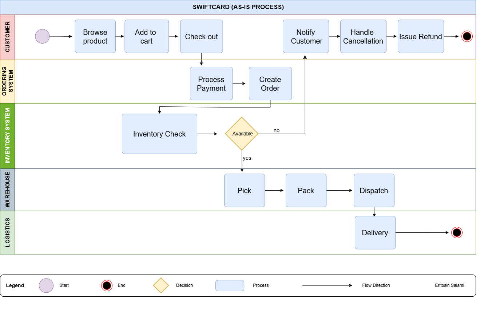

 

Using data analysis alongside 5whys (root-cause analysis) 

**GAP ANALYSIS** 
| Current State	| Desired State	| Gap |
| -------------------------------- | ----------------------------- | ----------------------------- |
| Delayed inventory updates | 	Near-real-time availability |	Integration gap |
| Manual fulfillment	| Integrated workflow	| Process/system  |
| Fragmented order information	| Central order view	| Visibility gap |
| Manual customer updates	| Automated notifications	| Communication gap |
| Manual delay detection	| SLA alerts	| Monitoring gap |
| Inconsistent cancellation reasons	| Standard reason codes	| Data-quality gap |

 
 

| Finding | Evidence / Observation	| Implication |
| -------------------------------- | ----------------------------- | ----------------------------- |
| Late delivery	| 34% of cancellations associated with late delivery	| Need proactive SLA monitoring and exception management |
| Product unavailable	| 27% associated with availability issues	| Need earlier inventory validation and reservation |
| Poor visibility	| 18% associated with poor status visibility	| Need unified order tracking and customer updates |
| Inventory synchronization	| Updates are delayed/inconsistent	| Customer-facing stock can differ from actual stock |
| Customer Service	| Agents use multiple systems	| Slow order investigation and resolution |
| Warehouse	| Manual fulfillment steps	| Higher delay and coordination risk |
| Notifications	| Updates are inconsistent	| Customers may cancel because they lack information |

 
 

**BUSINESS REQUIREMENTS** 
| ID	| Requirement	| Priority |
| -------------------------------- | ----------------------------- | ----------------------------- |
| BR-001	| Reduce avoidable customer cancellations	| High |
| BR-002	| Improve inventory availability accuracy	| High |
| BR-003	| Improve order fulfillment visibility	| High |
| BR-004	| Provide timely customer order information	| High |
| BR-005	| Identify delayed orders before cancellations	| High |
| BR-006	| Give Customer Service a complete order view	| Medium |
| BR-007	| Provide management with reliable cancellation/fulfillment analytics	| Medium |

 
 

**FUNCTIONAL REQUIREMENTS** 
| ID	| Functional Requirement	| Business Link |
| -------------------------------- | ----------------------------- | ----------------------------- |
| FR-001	| Validate product availability before order confirmation	| BR-002 |
| FR-002	| Reserve available inventory after confirmation	| BR-002 |
| FR-003	| Maintain defined order lifecycle statuses	| BR-003 |
| FR-004	| Provide estimated delivery date	| BR-004 |
| FR-005	| Send notifications at defined order events	| BR-004 |
| FR-006	| Flag orders that exceed fulfillment thresholds	| BR-005 |
| FR-007	| Allow authorized CS users to search/view orders	| BR-006 |
| FR-008	| Require standardized cancellation reason codes	| BR-001 |
| FR-009	| Allow customers to view tracking information	| BR-003 |
| FR-010	| Provide a unified CS order view across payment, inventory, fulfillment and delivery	| BR-006 |

 
 

**NON-FUNCTIONAL REQUIREMENTS**
| ID	| Requirement	| Category |
| -------------------------------- | ----------------------------- | ----------------------------- |
| NFR-001	| Order-status information should meet an agreed response-time threshold.	| Performance |
| NFR-002	| Only authorized users may access customer/order information.	| Security |
| NFR-003	| Status changes must be timestamped and auditable.	| Auditability |
| NFR-004	| Inventory/order information must remain consistent across integrations.	| Reliability |
| NFR-005	| Solution should support increased order volume without unacceptable degradation.	| Scalability |

 
 

**BUSINESS RULES & MoSCoW**
| Type	| Item |
| -------------------------------- | ----------------------------- |
| Rule	| Inventory must be validated before confirmation. |
| Rule	| Confirmed orders reserve available stock. |
| Rule	| Orders exceeding SLA are flagged. |
| Rule	| Every cancellation requires a standard reason code. |
| Rule	| Refunds must follow the approved refund policy. |
| Must	| Inventory validation, reservation, order confirmation, order tracking, order status, customer notifications, cancellation reason capture |
| Should	| Delay alerts, CS dashboard, management analytics |
| Could	| Cancellation prediction, notification  |
| Won't	| AI chatbot, complete website redesign, recommendation engine |

 
 
 

**USER STORIES AND ACCEPTANCE CRITERIA**

| ID 	| User Story | Acceptance Criteria |
| -------------------------------- | ----------------------------- | ----------------------------- |
| US-001 | As a customer, I want inventory validated before confirmation so I do not purchase an unavailable product. (inventory) |	Available stock is validated/reserved; unavailable stock prevents confirmation and shows an appropriate message.|
| US-002 | As a customer, I want to see my order status so I know where my order is. (Order tracking) |	Latest status, ETA and tracking number are displayed where available.|
| US-003 | As a customer, I want order updates so I know when my order progresses. (notification) |	Confirmation, dispatch, out-for-delivery, delivery and significant-delay notifications are triggered. |
| US-004 | As a CS agent, I want one order view so I can resolve customer issues quickly. (Customer service) |	Agent can retrieve order and see payment, inventory, fulfillment and delivery information, customer details, cancellation/refund. |
| US-005 | As an Operations Manager, I want delayed orders identified automatically so I can intervene before cancellation. (monitoring) |	SLA threshold is defined, orders monitored, flagged and visible to Operations. Escalation can occur |

**TO-BE PROCESS**

Customer → Select Product → Inventory Validation → Available? → Reserve Stock → Payment → Confirm Order → Automatic Warehouse Queue → Pick → Pack → Dispatch → Tracking Activated → Customer Notification → Delivery

If unavailable: Inform Customer → Alternative / Exit 

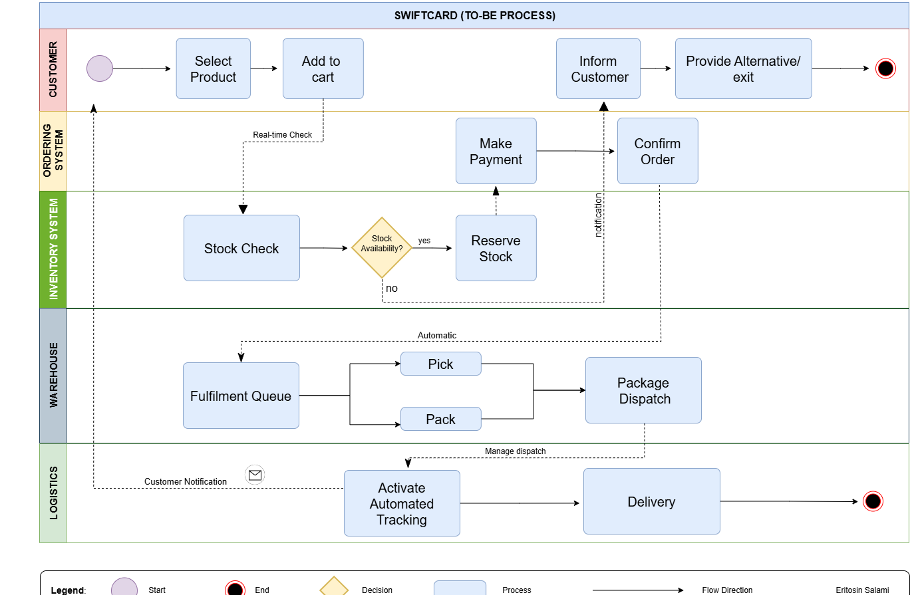 

 
 

**DATA FLOW DIAGRAM** 
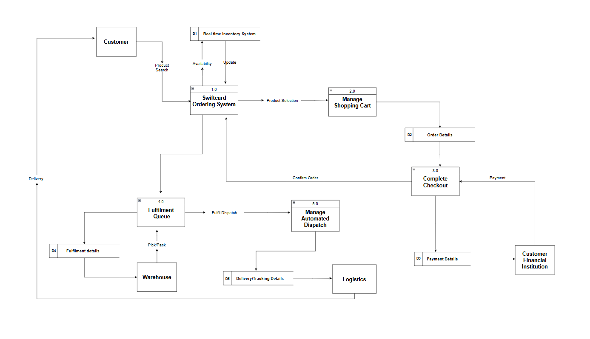

 

**PROPOSED SOLUTION**
| Component	| Purpose	| Key Capabilities |
| -------------------------------- | ----------------------------- | ----------------------------- |
| Inventory Integration	| Improve stock accuracy	| Availability validation, reservation, exception monitoring |
| Order Management	| Centralize lifecycle	| Status management, order IDs, exception states |
| Customer Visibility	| Reduce uncertainty	| Tracking, ETA, status, delay information |
| Operations Monitoring	| Enable intervention	| SLA alerts, cancellation dashboard, inventory exceptions |

 

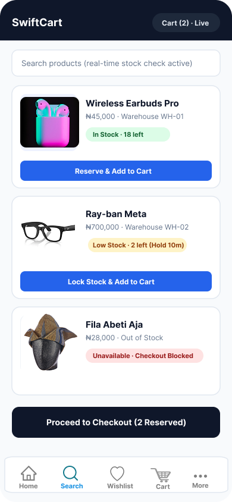

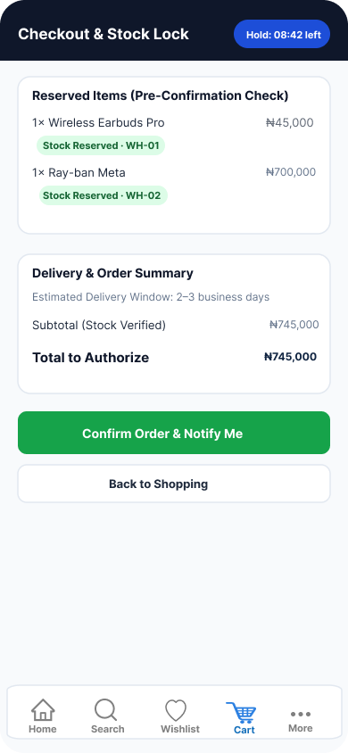

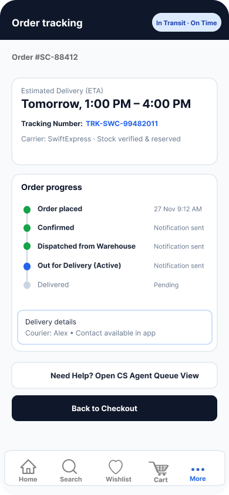

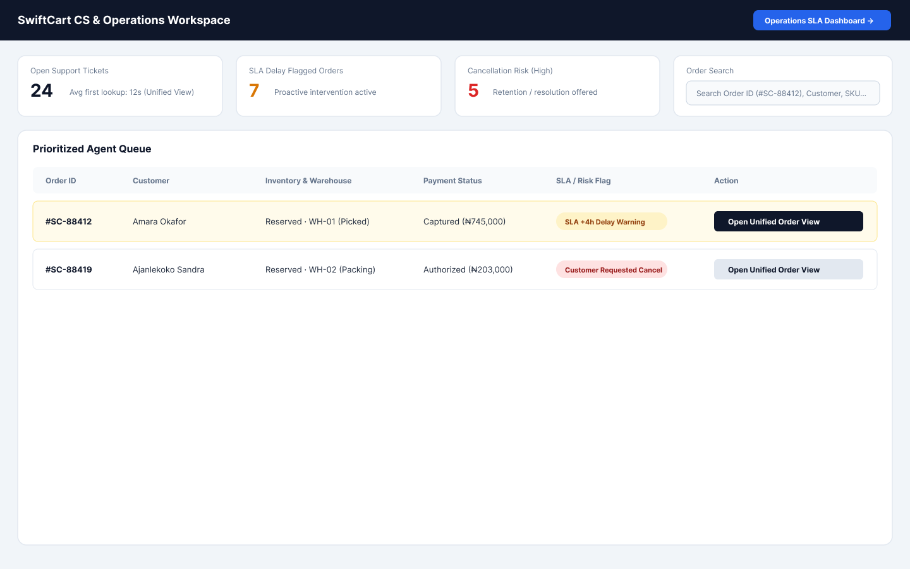

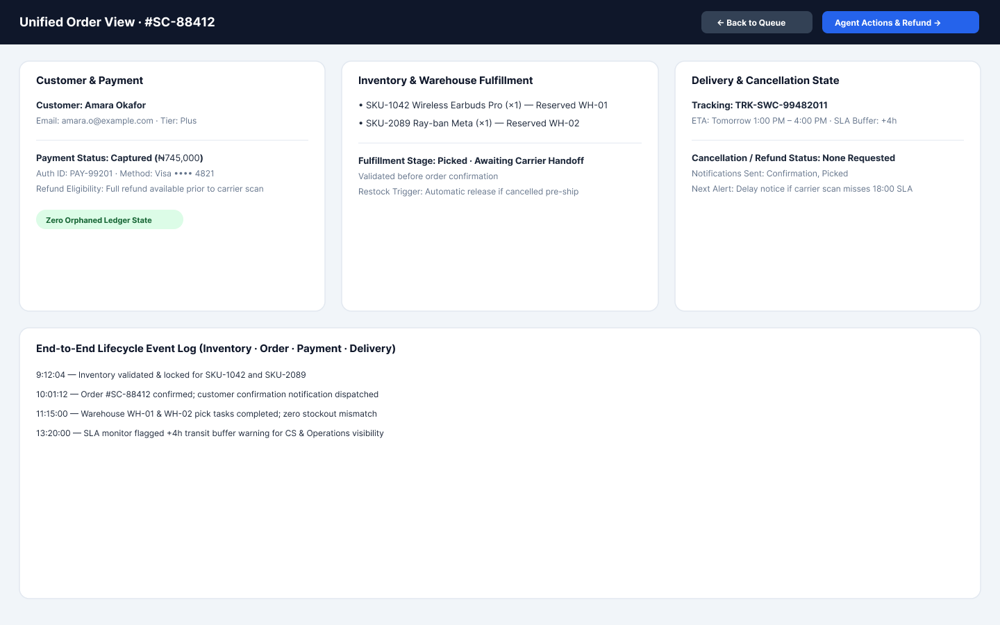

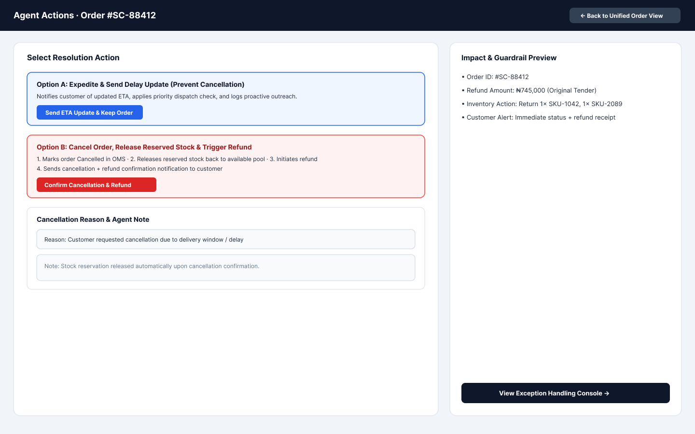

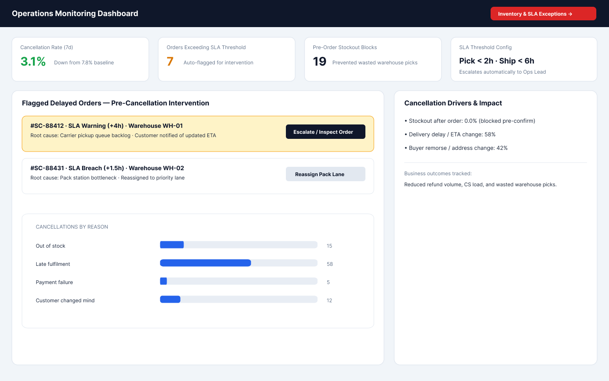

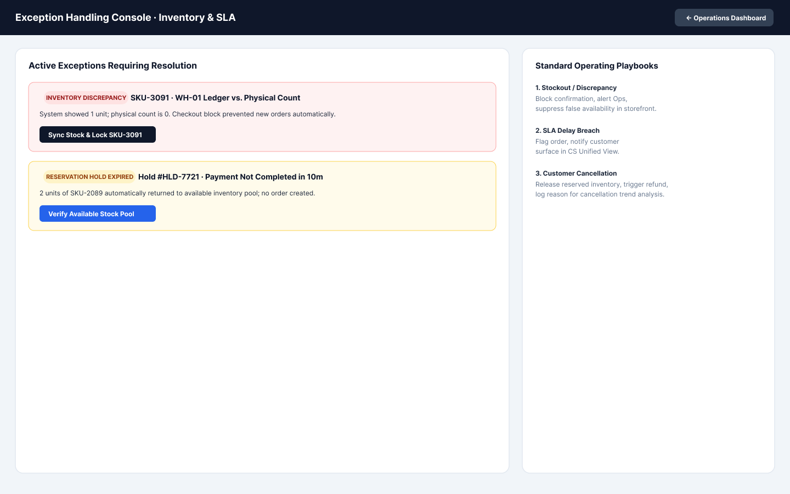

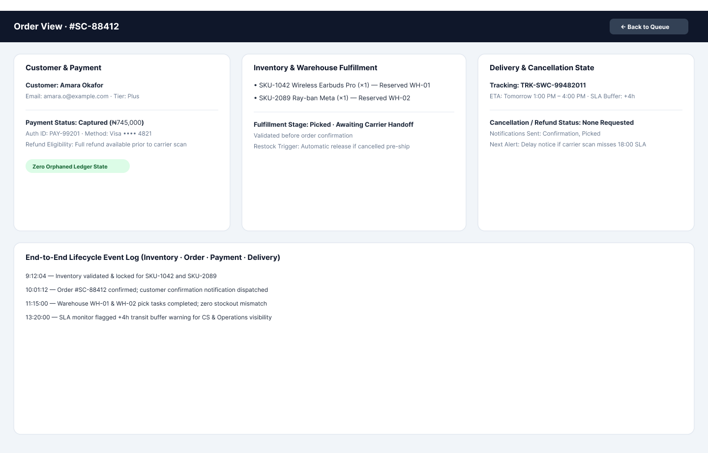

 
 

**AGILE BACKLOG**
| Sprint	| Epic	| Stories	| Priority |
| -------------------------------- | ----------------------------- | ----------------------------- | ----------------------------- |
| Sprint 1	| Inventory & order processing	| US-001 + reservation + order confirmation	| Highest |
| Sprint 2	| Customer visibility	| US-002 + ETA + tracking	| High |
| Sprint 3	| Communication	| US-003 + confirmation/dispatch/delay notifications	| High |
| Sprint 4	| Operations control	| US-004 + US-005 + cancellation analytics	| High/Medium |

 
 

**UAT TEST CASES**
| ID	| Scenario	| Precondition	| Action	| Expected Result |
| ---------- | ----------------------------- | ----------------------------- |  ----------------------------- | ----------------------------- |
| UAT-001	| Available product	| Inventory available	| Order placed	| Inventory validated/reserved and order confirmed |
| UAT-002	| Unavailable product	| No available stock	| Customer attempts order	| Order blocked and customer informed |
| UAT-003	| Tracking	| Active order exists	| Customer opens tracking	| Status, ETA and tracking displayed |
| UAT-004	| Delay alert	| Order exceeds SLA	| SLA threshold reached	| Order flagged for Operations |
| UAT-005	| CS unified view	| Customer contacts support	| Agent searches order	| Complete order information displayed |

 
 

**REQUIREMENT TRACEABILITY MATRIX**
| Business Req.	| Functional Req.	| User Story	UAT |
| -------------------------------- | ----------------------------- | ----------------------------- |
| BR-001	| FR-001 / FR-008	US-001	| UAT-002 |
| BR-002	| FR-001 / FR-002	US-001	| UAT-001 / UAT-002 |
| BR-003	| FR-003 / FR-009	US-002	| UAT-003 |
| BR-004	| FR-004 / FR-005	US-003	| UAT-003 |
| BR-005	| FR-006	US-005	| UAT-004 |
| BR-006	| FR-007 / FR-010	US-004	| UAT-005 |

 
 

**BUSINESS KPI**
| KPI	| Baseline (Simulated)	| Target	Post-Implementation |
| -------------------------------- | ----------------------------- | ----------------------------- |
| Cancellation rate	| 12%	| <7% |	
| Late delivery rate	| 21%	| <12%	|
| Inventory accuracy |	88%	| ≥97%	|
| CS order-resolution time	| 15 min	| <5 min	|
| Tracking visibility	| 60%	| ≥95% |	

 
link to the dataset (here)[https://github.com/SalamiEritosin/Swiftcart-/blob/main/dataset/SwiftCart_Synthetic_Order_Dataset.xlsx]

